<div align="center">

# 墨园 Ink Garden

**A slow, beautiful path to Chinese — everything you need for HSK 1 to HSK 6 in one quiet place.**

Stroke order · iPad tracing · native-speaker audio · grammar · picture scenes · 56 poems · real novels · 180 mock tests · flashcards

Free · no account · no ads · works offline · phone, iPad and laptop

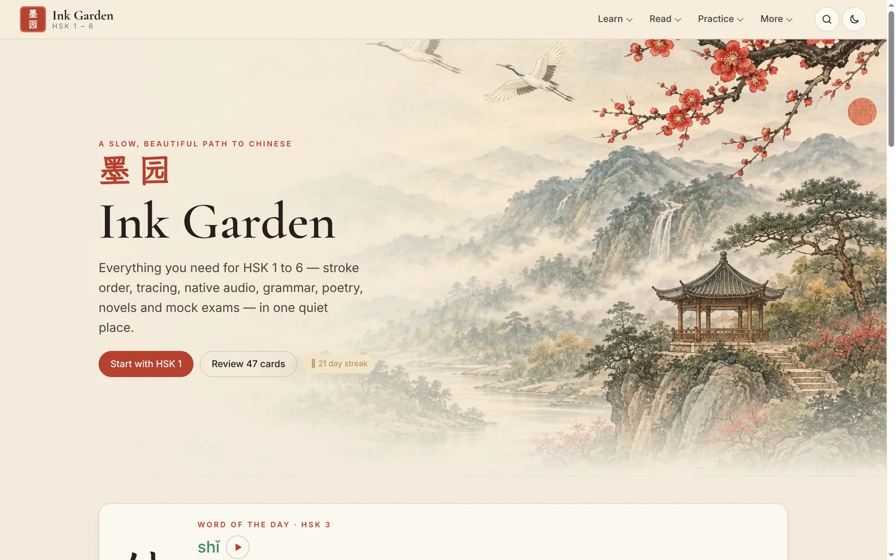

</div>

---

## Contents

1. [Getting started](#1-getting-started)
2. [Find your way around](#2-find-your-way-around)
3. [Levels & words](#3-levels--words)
4. [Stroke order](#4-stroke-order)
5. [Tracing & writing practice (great on iPad)](#5-tracing--writing-practice-great-on-ipad)
6. [Pinyin & tones](#6-pinyin--tones)
7. [Pronunciation checker](#7-pronunciation-checker)
8. [Grammar](#8-grammar)
9. [Sentence building](#9-sentence-building)
10. [Picture scenes](#10-picture-scenes)
11. [Poems](#11-poems)
12. [Novels](#12-novels)
13. [Mock tests](#13-mock-tests)
14. [Flashcards](#14-flashcards-spaced-repetition)
15. [My progress & backups](#15-my-progress--backups)
16. [Resources](#16-resources)
17. [Night mode, search & shortcuts](#17-night-mode-search--shortcuts)
18. [A suggested daily routine](#18-a-suggested-daily-routine)
19. [Troubleshooting](#19-troubleshooting)
20. [Putting the site online](#20-putting-the-site-online)
21. [For developers](#21-for-developers)
22. [Credits & licences](#22-credits--licences)

---

## 1. Getting started

**Open the website** in any modern browser (Safari, Chrome, Edge or Firefox). There is nothing to sign up for. Everything you do — flashcards, test scores, saved poems, your streak — is saved automatically **in your own browser on your own device**.

**Install it like an app (recommended on iPad and phone):**

| Device | How |
| --- | --- |
| iPad / iPhone (Safari) | Tap the **Share** button (square with an arrow) → **Add to Home Screen** → **Add** |
| Android (Chrome) | Tap the **⋮** menu → **Add to Home screen** / **Install app** |
| Laptop (Chrome / Edge) | Click the **install** icon at the right end of the address bar |

Once installed it opens full-screen without browser bars (perfect for tracing with an Apple Pencil), and pages you've already visited keep working offline.

**Where to begin?**
- Complete beginner → read [Pinyin & tones](#6-pinyin--tones) first, then open **HSK 1**.
- Already know some Chinese → take a [mock test](#13-mock-tests) to see which level fits, then start at that level.

The site works the same on every screen size — here it is on a phone and on an iPad:

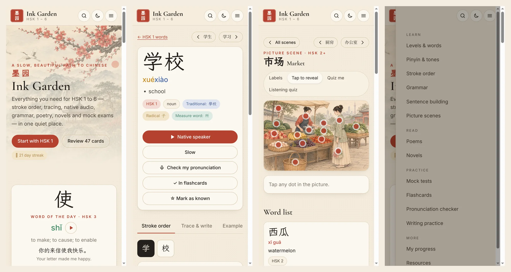

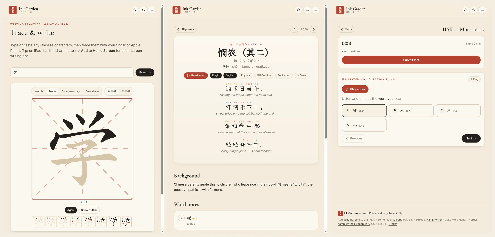

---

## 2. Find your way around

The menu at the top has four groups (on a phone, tap **☰** in the top-right corner):

| Menu | Pages |
| --- | --- |
| **Learn** | Levels & words · Pinyin & tones · Stroke order · Grammar · Sentence building · Picture scenes |
| **Read** | Poems · Novels |
| **Practice** | Mock tests · Flashcards · Pronunciation checker · Writing practice |
| **More** | My progress · Resources |

The two round buttons next to the menu are **search** (magnifying glass) and **night mode** (moon).

The **home page** shows:
- **Start with HSK 1** and **Review N cards** buttons — the review button tells you how many flashcards are due today.
- Your **day streak**.
- **Word of the day** — a new word every day, with audio and an example sentence. Tap **Open word** or **Trace it**.
- The six levels with your progress bars, and a card for every part of the site.

<details>
<summary><b>See the whole home page</b></summary>

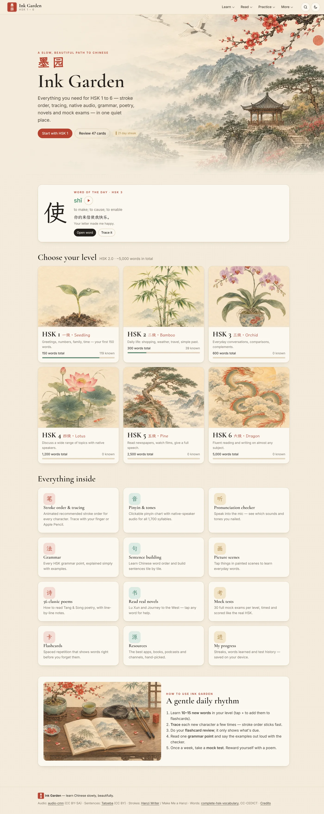

</details>

---

## 3. Levels & words

**Learn → Levels & words** shows the six HSK levels. Each has its own painting and tells you how many words it adds:

| Level | Name | New words | Total words |
| --- | --- | --- | --- |
| HSK 1 | 一级 Seedling | 150 | 150 |
| HSK 2 | 二级 Bamboo | 147 | ~300 |
| HSK 3 | 三级 Orchid | 298 | ~600 |
| HSK 4 | 四级 Lotus | 598 | ~1,200 |
| HSK 5 | 五级 Pine | 1,298 | ~2,500 |
| HSK 6 | 六级 Dragon | 2,500 | ~5,000 |

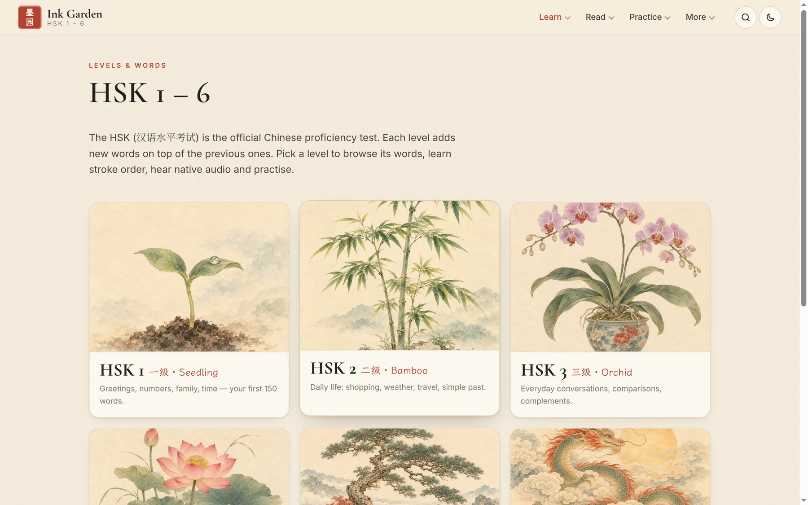

### A level page

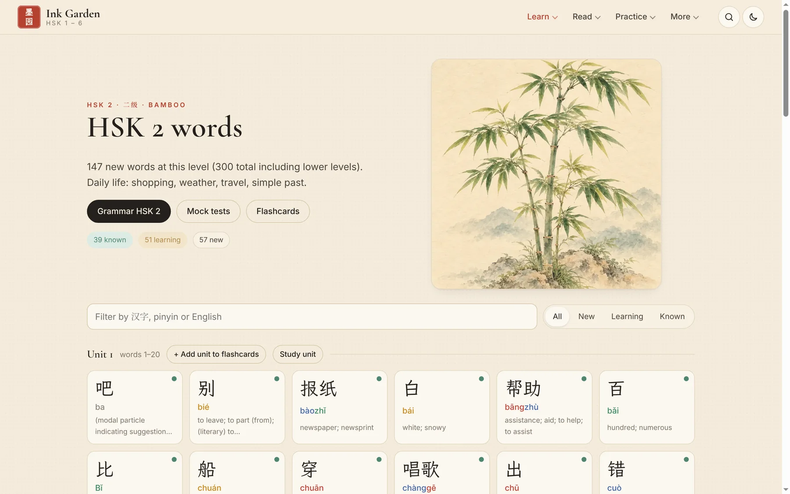

- Words are split into **units of 20** so you can learn a little at a time.
- **Filter** box — type 汉字, pinyin or English to find a word.
- **All / New / Learning / Known** — show only the words you haven't started, are learning, or know.
- **+ Add unit to flashcards** — puts all 20 words of that unit into your flashcard deck.
- **Study unit** — starts flashcards for just that unit.
- The **coloured dot** on each word card shows its status (none = new, gold = learning, green = known).
- Buttons at the top jump to this level's **grammar**, **mock tests** and **flashcards**.

### A word page

Tap any word to open it.

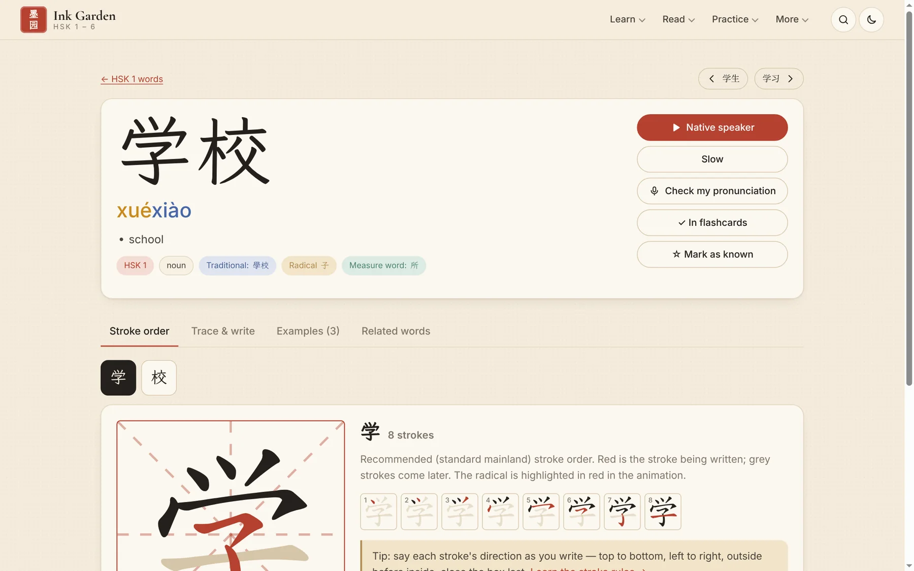

- **Native speaker** — plays a real recording of a native speaker (available for about 90% of words; the rest use your device's Chinese voice). **Slow** plays it slower.
- **Check my pronunciation** — opens the [pronunciation checker](#7-pronunciation-checker) for this word.
- **+ Flashcards** — adds the word to your deck. **Mark as known** — skips words you already know.
- The chips show the HSK level, part of speech, traditional form, radical and measure word (量词).
- Four tabs:
  - **Stroke order** — an animation for every character plus a stroke-by-stroke strip (see [Stroke order](#4-stroke-order)).
  - **Trace & write** — trace the word right there (see [Tracing](#5-tracing--writing-practice-great-on-ipad)).
  - **Examples** — real sentences that use the word, with pinyin over each character, English and audio.
  - **Related words** — other HSK words that share a character.
- The **‹ ›** arrows in the top-right go to the previous / next word.

---

## 4. Stroke order

**Learn → Stroke order** teaches the foundations before you write anything.

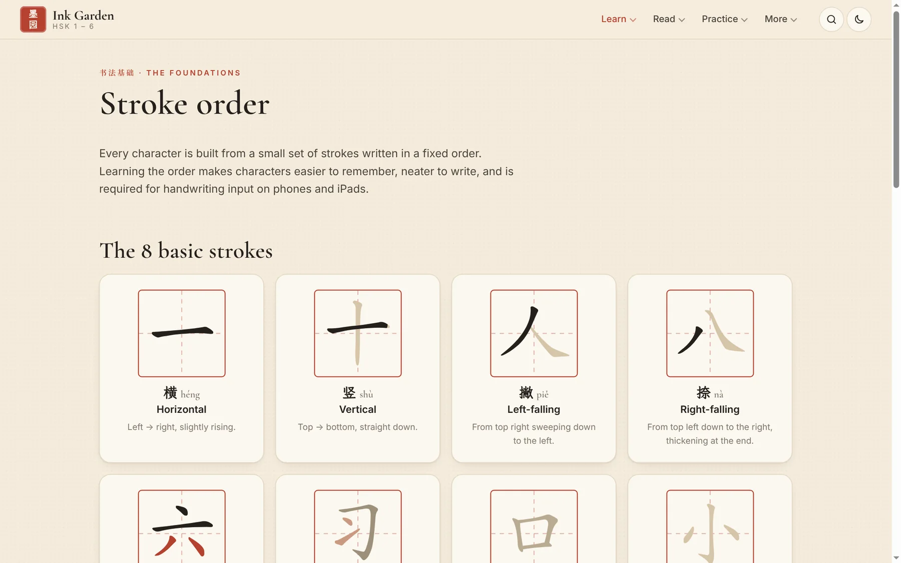

- **The 8 basic strokes** — 横 héng, 竖 shù, 撇 piě, 捺 nà, 点 diǎn, 提 tí, 折 zhé, 钩 gōu — with direction and an example character that animates.
- **The 9 stroke-order rules** — e.g. 先横后竖 *horizontal before vertical*, 从上到下 *top to bottom*, 从左到右 *left to right*, 从外到内 *outside before inside*, 先里头后封口 *fill the inside, then close the box* — each with an animated example. Tap any character to replay it.
- **24 common radicals** — the building blocks that hint at meaning (氵 water, 口 mouth, 木 tree…).

Every one of the ~5,000 HSK words has the recommended (standard mainland) stroke order. In the animations, **red** shows the radical and the stroke strip shows each new stroke in red.

---

## 5. Tracing & writing practice (great on iPad)

You can trace on any word page (**Trace & write** tab) or on **Practice → Writing practice**, where you can type or paste **any** Chinese characters — your own words, a poem line, your name.

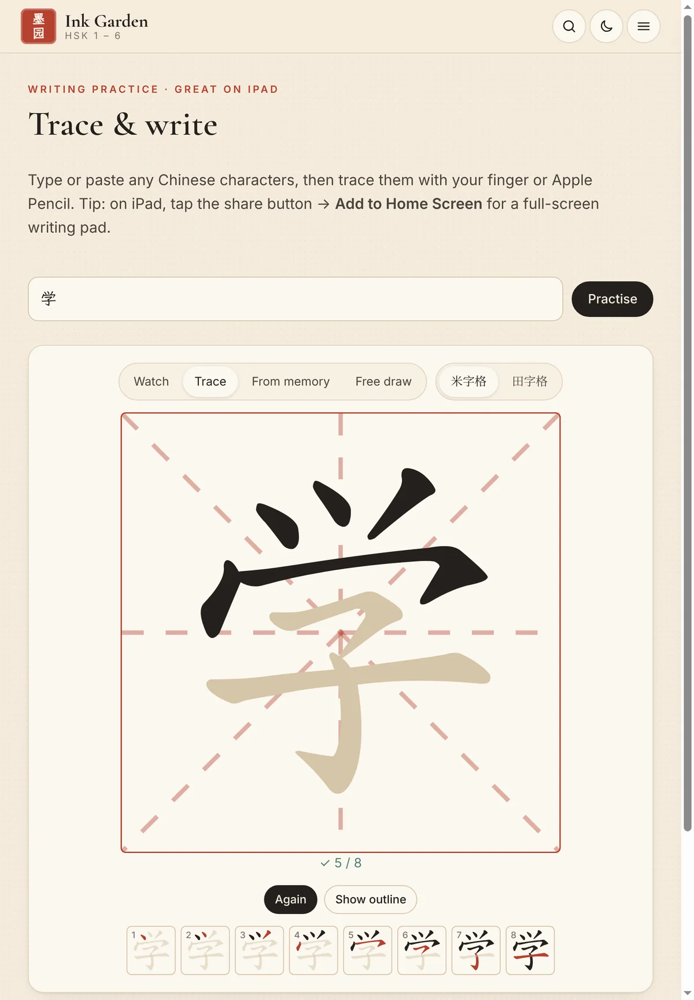

**How to use it:**
1. Type characters in the box (e.g. `你好`) and tap **Practise**. If you type several, tap them in the row underneath to switch.
2. Choose a mode:
   - **Watch** — the character draws itself, stroke by stroke, on a loop.
   - **Trace** — a grey outline is shown; draw over it with your finger or Apple Pencil. Each stroke is checked: a correct stroke snaps into ink, a wrong one fades away. After 2 misses a hint flashes.
   - **From memory** — no outline. Hints appear after 3 misses.
   - **Free draw** — a blank practice sheet with the character faintly in the background, like calligraphy paper. Apple Pencil pressure changes the line width. Use **Undo**, **Clear** and **Hide guide**.
3. Pick your grid: **米字格** (with diagonals) or **田字格** (cross only).
4. When you finish, you'll see how many mistakes you made (or 完美 — perfect!). If you typed several characters it moves on to the next one by itself. Tap **Again** to repeat a character, or **Show outline** if you're stuck.

**Tips:** write each new character 3–5 times in **Trace**, then once **From memory**. On iPad, install the site to your home screen first so the page doesn't scroll while you write.

---

## 6. Pinyin & tones

**Learn → Pinyin & tones** is a complete pronunciation course. Every sound is a real recording.

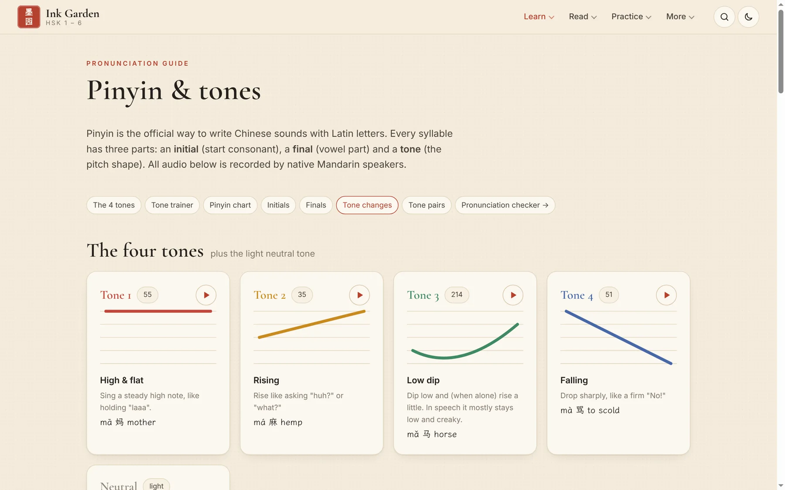

Use the buttons at the top to jump between sections:
- **The 4 tones** (+ neutral tone) — what each tone sounds and looks like, with audio.
- **Tone trainer** — you hear a syllable and guess the tone. Great for training your ear.
- **Pinyin chart** — every syllable in Mandarin. Tap a syllable to hear it in all four tones, or choose **1st–4th** to play just one tone on each tap.
- **Initials** and **Finals** — each sound explained in plain English, including the tricky ones (zh ch sh r, j q x, ü).
- **Tone changes** — the rules for 一, 不 and two 3rd tones in a row.
- **Tone pairs** — practise all 20 two-syllable tone combinations with real words.

---

## 7. Pronunciation checker

**Practice → Pronunciation checker** — or **Check my pronunciation** on any word or poem.

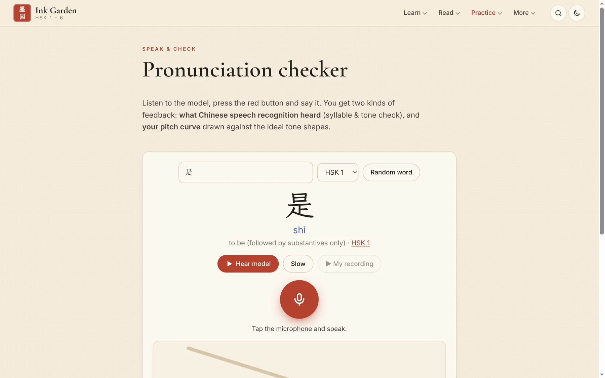

1. Type a word or sentence, pick one with **HSK level + Random word**, or arrive from a word page.
2. Tap **Hear model** (or **Slow**) to listen.
3. Tap the big red **microphone** and say it. It stops by itself when you finish (or tap it again).
4. You get two kinds of feedback:
   - **What was heard** — your speech is turned into text and each syllable is marked green (right) or red (wrong sound or tone).
   - **Your pitch curve** — a line showing how your voice rose and fell, drawn on top of the ideal tone shapes. If tone 4 should fall and your line is flat, you'll see it.
5. **My recording** plays back what you said, so you can compare it to the model.

> The browser will ask for permission to use the microphone the first time — tap **Allow**. Syllable checking needs speech recognition, which works in **Chrome, Edge and Safari** (including iPad/iPhone). The pitch curve works in every browser.

---

## 8. Grammar

**Learn → Grammar** has **80 grammar points** across all six levels, in a sensible teaching order.

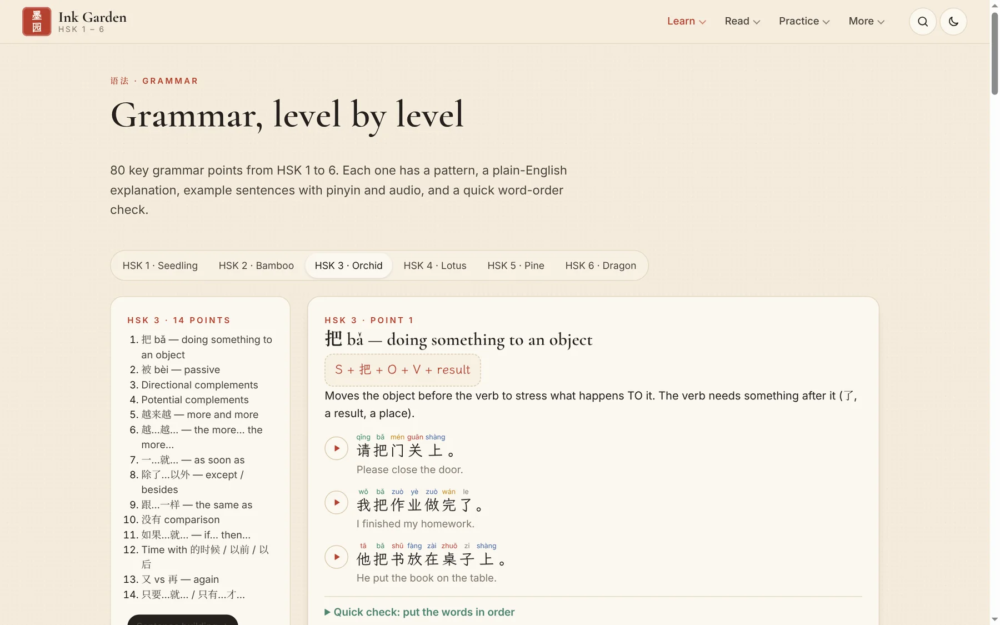

- Choose a level with the tabs at the top. The list on the left jumps to any point.
- Every point has: a **pattern** (e.g. `S + 把 + O + V + result`), a **plain-English explanation**, and **example sentences** with pinyin, translation and a ▶ button to hear them.
- Open **Quick check** at the bottom of a card: tap the word tiles in the right order to build the sentence. You'll be told immediately whether it's right.

Topics include word order, 是, 很, 吗, 不/没, 的, measure words, 了, 过, 着, 正在, comparisons with 比, duration, complements (result, direction, potential, degree), 把 and 被, 越来越, 一…就…, 如果…就…, 不但…而且…, 即使…也… and advanced written structures for HSK 5–6.

---

## 9. Sentence building

**Learn → Sentence building** teaches you *how Chinese sentences are put together* and then lets you build hundreds of real ones.

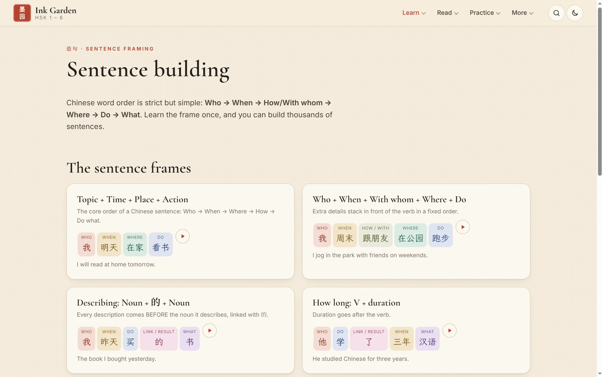

- **The sentence frames** — six colour-coded templates. The main one: **Who → When → Where → Do → What** (我 明天 在家 看 书). Every word is labelled with its role and colour.
- **Practice** — pick a level; you get a real sentence from Tatoeba in shuffled word tiles. Tap the tiles in the right order. Turn **pinyin** on or off. Tap **Next** for another — there are about 9,000 sentences across the six levels.

---

## 10. Picture scenes

**Learn → Picture scenes** — 12 hand-painted everyday places with **188 words** to discover: bedroom, classroom, Spring Festival dinner, home, hospital, kitchen, market, office, park, restaurant, train station and street.

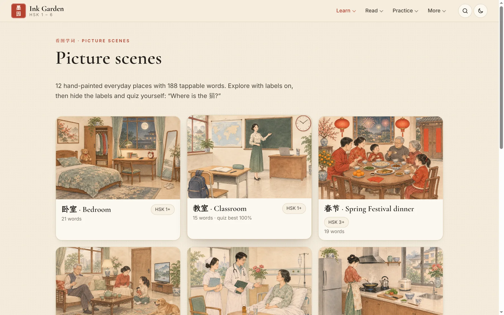

Open a scene and choose a mode at the top:

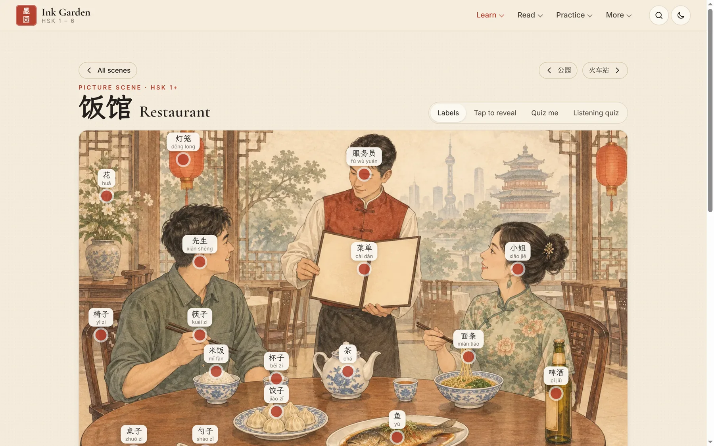

- **Labels** — every object is labelled with 汉字 and pinyin. Tap a label to hear it and see its meaning.
- **Tap to reveal** — labels are hidden as red dots; tap a dot to see and hear the word.
- **Quiz me** — the app names a word, you tap the right thing in the picture. Your best score is saved.
- **Listening quiz** — the same, but you only hear the word.

Underneath is a **word list** with links to each word's page. Use the **‹ ›** buttons to move between scenes.

---

## 11. Poems

**Read → Poems** — **56 poems**, from Tang dynasty classics (李白, 杜甫, 王维, 白居易) and Song lyrics (苏轼, 李清照, 陆游) to modern poems like 徐志摩's 再别康桥.

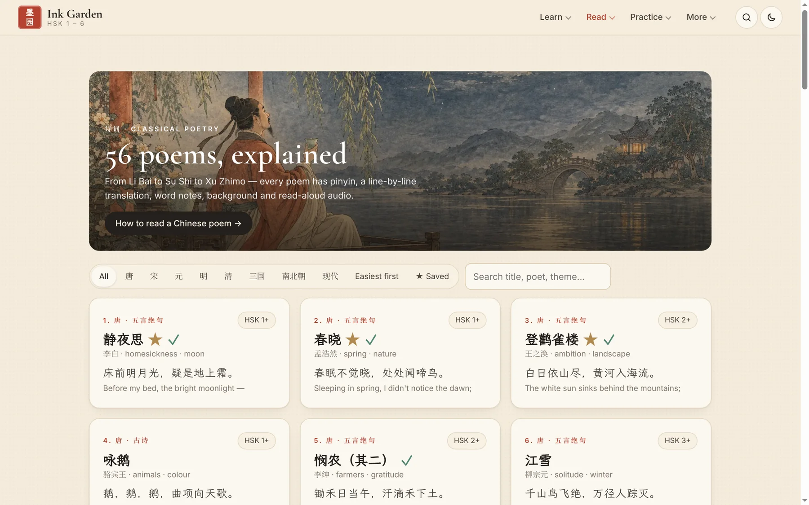

- Filter by **dynasty**, **search** by title / poet / theme, sort **easiest first**, or show only your **★ Saved** poems.
- A ✓ shows poems you've memorised. Each card shows an HSK level, so you know how hard it is.

### Reading a poem

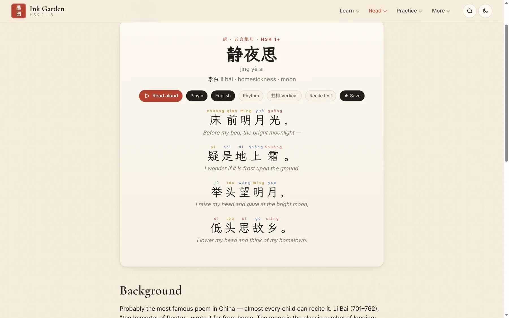

- **Read aloud** — the whole poem, slowly.
- **Pinyin** / **English** — show or hide pinyin over every character and the line-by-line translation.
- **Rhythm** — marks the pauses (classical lines split 2 + 2 + 3 or 2 + 3).
- **竖排 Vertical** — shows the poem the traditional way: top to bottom, right to left.
- **Recite test** — blanks out some characters; say the poem and tap a blank to check it. Tap **Hide more** to make it harder until the whole poem is hidden. When you can say it all, tap **Mark as memorised**.
- **★ Save** — keep it in your favourites.
- Below the poem: the **background** (who wrote it, when and why), **word notes** for every difficult word, and links to **trace** the poem's characters or **check your pronunciation** of it.

**New to classical poetry?** Start with **How to read a Chinese poem** at the top of the poems page — it explains poem forms, rhythm, how classical Chinese drops words, parallel lines, rhyme, common symbols (moon = home, willow = farewell…) and how to read aloud.

---

## 12. Novels

**Read → Novels** — three complete pieces of real Chinese literature:

| Text | Author | Length | Level |
| --- | --- | --- | --- |
| 孔乙己 *Kong Yiji* | 鲁迅 Lu Xun, 1919 | 2,600 characters | HSK 5+ |
| 故乡 *My Old Home* | 鲁迅 Lu Xun, 1921 | 5,000 characters | HSK 5+ |
| 西游记 · 第一回 *Journey to the West, Ch. 1* | 吴承恩 Wu Cheng'en, 1592 | 6,900 characters | HSK 6+ |

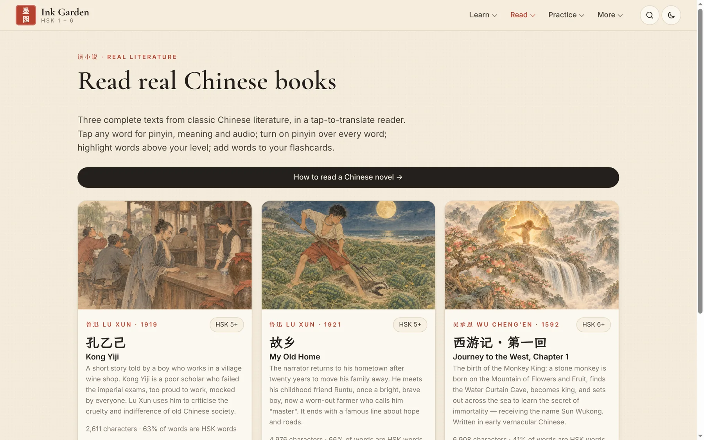

### The reader

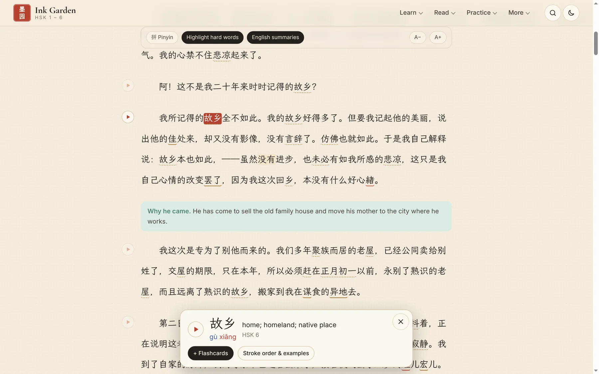

- **Tap any word** — a card pops up with pinyin, the meaning, its HSK level and audio. Tap **+ Flashcards** to keep it, or **Stroke order & examples** to open the full word page.
- **拼 Pinyin** — pinyin above every word. Turn it off as you get better.
- **Highlight hard words** — underlines words above HSK 4 (dotted gold = HSK 5, gold = HSK 6, red = beyond HSK), so you can see at a glance how hard a paragraph is.
- **English summaries** — short green boxes that tell you what happens in each section. Read them first, then the Chinese.
- **A− / A+** — text size.
- **▶** next to each paragraph — hear it read aloud.
- The reader **remembers where you stopped** — when you come back, tap **Continue reading**.
- At the top: **reading tips** for that text (old-style words, famous lines) and the **key vocabulary** list.

Start with **How to read a Chinese novel** on the novels page — an 8-step method plus what to read next.

---

## 13. Mock tests

**Practice → Mock tests** — **30 full mock tests for every level (180 in total)** in HSK format, plus unlimited practice.

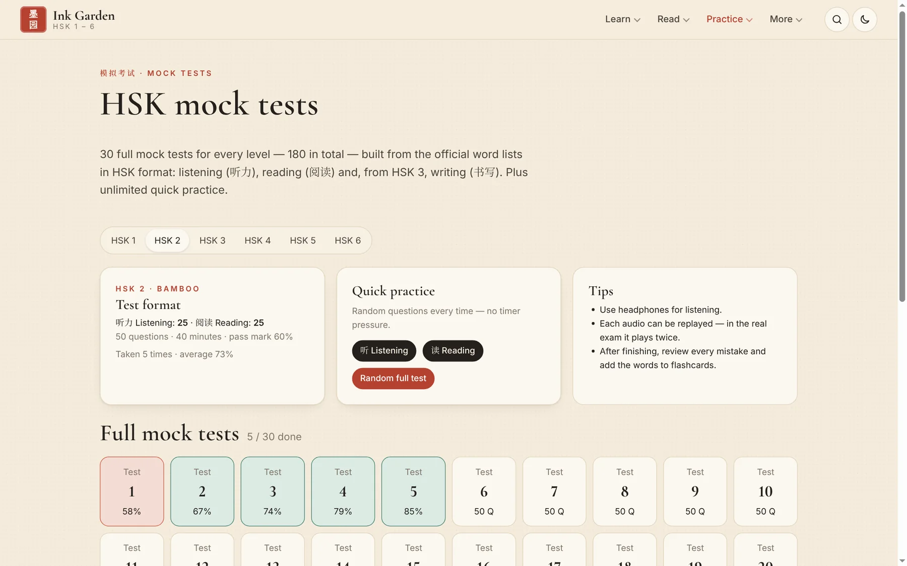

| Level | 听力 Listening | 阅读 Reading | 书写 Writing | Time |
| --- | --- | --- | --- | --- |
| HSK 1 | 20 | 20 | – | 30 min |
| HSK 2 | 25 | 25 | – | 40 min |
| HSK 3 | 25 | 25 | 10 | 55 min |
| HSK 4 | 25 | 30 | 10 | 65 min |
| HSK 5 | 30 | 30 | 10 | 75 min |
| HSK 6 | 30 | 35 | 10 | 85 min |

**How to take a test:**
1. Pick your level, then tap a test number (1–30). Tests you've taken turn **green** (passed, 60%+) or **red**, with your best score.
2. **Listening questions** play automatically; tap **Play audio** to hear again. Use headphones.
3. Tap an answer, then **Next**. Use **⚑ Flag** to mark questions you want to come back to. The panel on the right (on a phone, tap **All questions**) shows every question and lets you jump around.
4. The timer shows how long you've taken; it turns red if you go over the official time.
5. Tap **Submit test** when you're done.

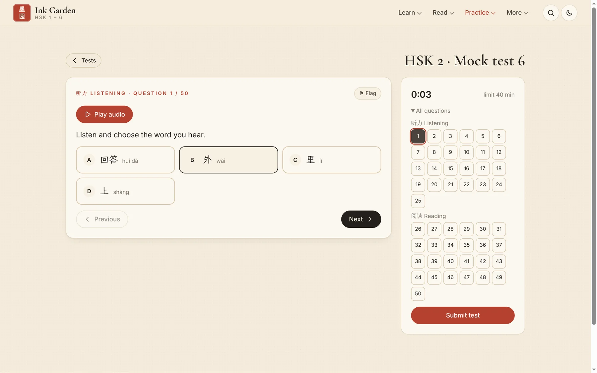

**Question types:** hear a word → choose it; hear a word → choose its meaning; hear a sentence → choose the translation; true/false listening; word meanings; fill in the blank (选词填空) in real sentences; sentence meaning; put words in the right order (连词成句); and choose the right character for a pinyin (from HSK 3).

### Results

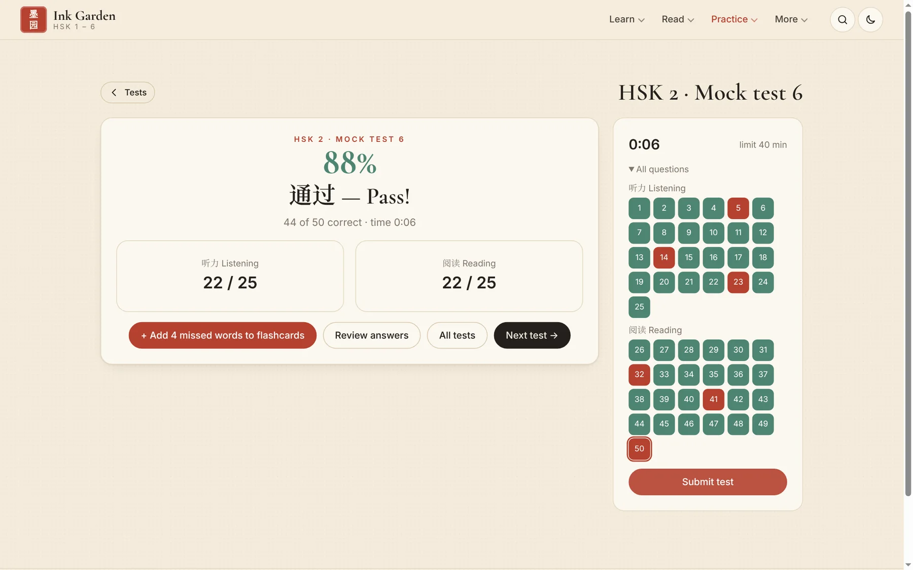

- Your score, pass / not yet, and a score for each section.
- **+ Add missed words to flashcards** — one tap puts every word you got wrong into your deck. This is the most useful button on the site!
- **Review answers** — go through each question with the correct answer and an explanation. Question numbers turn green or red.
- **Next test →** goes straight to the next one.

**Quick practice** (on the tests page): random **Listening**, **Reading** or **Writing** questions, or a **Random full test** — different every time, so you'll never run out.

---

## 14. Flashcards (spaced repetition)

**Practice → Flashcards** — the fastest way to remember words long-term.

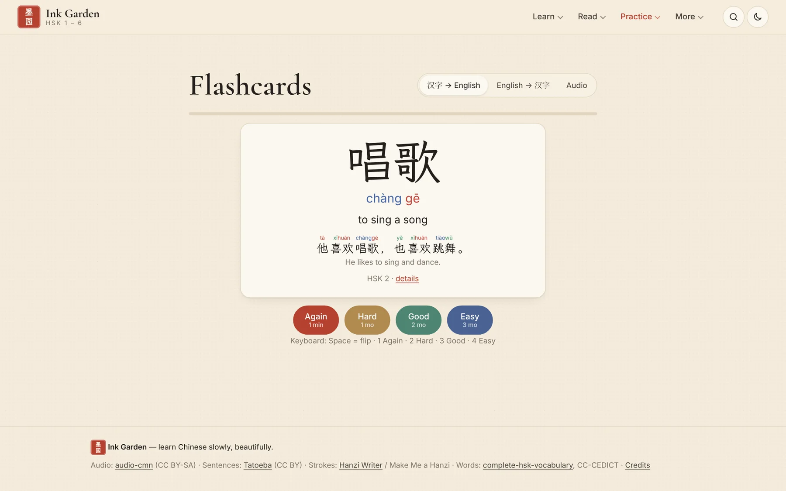

**Adding words:** use **+ Flashcards** on any word, **+ Add unit to flashcards** on a level page, **+ Add missed words** after a test, **+ Flashcards** in the novel reader, or a **starter pack** of 20 words (shown when your deck is empty).

**Reviewing:**
1. Look at the card and try to remember the answer. Tap the card or **Show answer**.
2. The back shows the word, pinyin, meaning, an example sentence and plays the audio.
3. Rate yourself honestly. Under each button you can see when the card will come back:
   - **Again** — forgot it → back in 1 minute
   - **Hard** — remembered with difficulty → soon
   - **Good** — remembered → in a few days
   - **Easy** — instantly → even later
4. Words you know well come back less and less often (days → weeks → months). Words you forget come back quickly. About 10 minutes a day is enough.

Choose the direction at the top: **汉字 → English**, **English → 汉字**, or **Audio** (listen only).

**Keyboard:** `Space` = show answer · `1` Again · `2` Hard · `3` Good · `4` Easy.

A word counts as **known** once its review interval reaches 3 weeks (or if you tap **Mark as known**).

---

## 15. My progress & backups

**More → My progress**

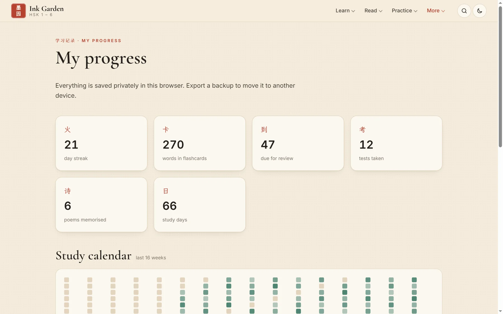

- **Day streak**, words in flashcards, cards due, tests taken, poems memorised and study days.
- **Study calendar** — the last 16 weeks; darker green = more study that day.
- **Words by level** — known (green) and learning (gold) for each level.
- **Test scores** — a chart of your recent results.

**Your progress lives in this browser only.** To move it to another device, or to keep it safe:
- **Export progress** — downloads a small `.json` file.
- **Import** — choose that file on the other device.
- **Reset everything** — deletes all progress (it asks first).

> Clearing your browser's history / website data also deletes progress, so export a backup now and then.

---

## 16. Resources

**More → Resources** — hand-picked dictionaries (Pleco, MDBG…), official HSK information, apps (Anki, Du Chinese, Skritter…), podcasts and YouTube channels, graded readers, grammar references, language exchange, and TV, film and music. Every card opens the site in a new tab. At the bottom are full credits for the open data used on this site.

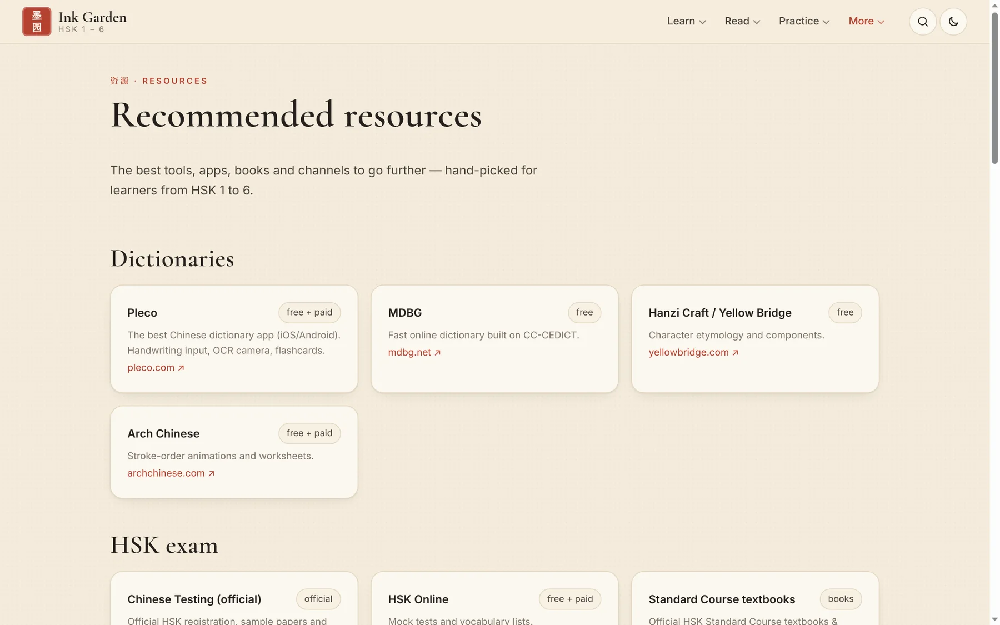

---

## 17. Night mode, search & shortcuts

**Night mode** — tap the moon button in the top bar. Your choice is remembered. (The site follows your device's dark mode the first time you visit.)

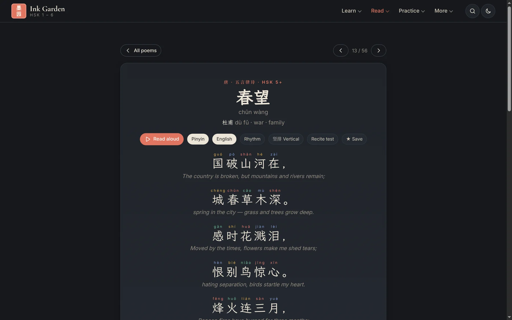

**Search** — tap the magnifying glass (or press `/` or `Ctrl/⌘ + K`) and type 汉字, pinyin (with or without tones, e.g. `xuexi`) or English. It searches all ~5,000 HSK words; tap a result to open the word.

| Shortcut | Where | Does |
| --- | --- | --- |
| `/` or `Ctrl/⌘ + K` | anywhere | open search |
| `Esc` | search | close |
| `Space` | flashcards | show answer |
| `1` `2` `3` `4` | flashcards | Again / Hard / Good / Easy |

---

## 18. A suggested daily routine

About 30 minutes a day:

1. **Flashcards** — clear all cards that are due (~10 min).
2. **Learn 10–15 new words** from your level: listen to each, watch the stroke order, then **trace** it a few times.
3. **One grammar point** — read it, listen to the examples, do the quick check.
4. **Speak** — say a few new words in the **pronunciation checker**.
5. **Once a week** — take a **mock test** and add your missed words to flashcards.
6. **For fun** — learn a poem, explore a picture scene, or read a few paragraphs of a novel.

Roughly how long each level takes at this pace: HSK 1 – 1 month · HSK 2 – 1–2 months · HSK 3 – 3 months · HSK 4 – 6 months · HSK 5 – 9 months · HSK 6 – a year or more.

---

## 19. Troubleshooting

| Problem | Fix |
| --- | --- |
| **No sound** | Check your device isn't on silent (on iPhone, the side switch). Tap a play button once — browsers only allow sound after you've tapped the page. |
| **Words without a recording sound robotic** | Those use your device's built-in Chinese voice. For a better voice on iPad/iPhone: **Settings → Accessibility → Spoken Content → Voices → Chinese** and download an enhanced voice. |
| **Microphone doesn't work** | Allow microphone access when asked. If you said no: in Safari, **aA → Website Settings → Microphone → Allow**; in Chrome, click the icon left of the address and allow the microphone. |
| **Pronunciation checker only shows the pitch curve** | Your browser doesn't support speech recognition (e.g. Firefox). Use Chrome, Edge or Safari. |
| **The page moves while I trace on iPad** | Add the site to your home screen and open it from there. |
| **My progress disappeared** | It's stored per browser and per device. Use **Export / Import** on the progress page to move it. |
| **A character shows "stroke data unavailable"** | A very small number of rare characters (6 of ~3,950) have no stroke data. |
| **Page looks old after an update** | Refresh the page once or twice — the offline cache updates in the background. |
| **Opening `index.html` directly shows nothing** | The site must be served from a web address (see below), not opened as a file. |

---

## 20. Putting the site online

The site is plain files, so it can be hosted for free.

**GitHub Pages (easiest):**
1. On GitHub, open this repository → **Settings** (top right).
2. Click **Pages** in the left menu.
3. Under **Build and deployment → Branch**, choose **main** and **/(root)**, then **Save**.
4. After a minute or two the site is live at `https://<your-username>.github.io/ink-garden-hsk/`.

**Run it on your own computer:** open a terminal in this folder and run

```bash
python3 -m http.server 8000
```

then visit http://localhost:8000.

---

## 21. For developers

Plain HTML, CSS and JavaScript modules — no framework and no build step.

```
index.html            app shell, navigation, fonts
css/style.css         the whole design system (paper + night themes)
js/app.js             hash router (#/level/1, #/word/1-0010 …), search, theme, menu
js/lib/               data loading, audio, storage + spaced repetition, Hanzi Writer helpers, mock-test generator
js/pages/             one file per page
js/content/           hand-written grammar, poems, scenes and novel notes
data/hsk1-6.json      vocabulary (pinyin, meanings, radicals, examples, audio refs)
data/sentences1-6     example / practice sentences per level
data/strokes/         stroke data per character (named by Unicode code point)
data/novels/          tokenised, annotated novel texts
audio/w, audio/s      word and syllable recordings
art/                  illustrations and app icons
vendor/               Hanzi Writer, pinyin-pro
build/                Python scripts that regenerate data/ from the open sources
sw.js, manifest.webmanifest   offline support + installable app
```

- Progress is stored in `localStorage` under the key `inkgarden.v1`.
- Mock tests are generated from the word lists and sentences with a fixed seed per test number, so *Test 7* is always the same test.
- To rebuild data: `build/build_vocab.py`, `build/build_strokes.py`, `build/build_novels.py` (needs `jieba` and `pypinyin`).
- `.nojekyll` is required for GitHub Pages because some audio files begin with `_`.

---

## 22. Credits & licences

- **HSK word lists** — [complete-hsk-vocabulary](https://github.com/drkameleon/complete-hsk-vocabulary) (MIT)
- **Audio** — [audio-cmn](https://github.com/hugolpz/audio-cmn) by hugolpz and contributors (CC BY-SA); the `audio/` folder is shared under the same licence
- **Example sentences** — [Tatoeba](https://tatoeba.org) (CC BY 2.0 FR)
- **Stroke data** — [Hanzi Writer](https://hanziwriter.org) / Make Me a Hanzi (Arphic Public License)
- **Dictionary** — [CC-CEDICT](https://cc-cedict.org) (CC BY-SA 4.0)
- **Pinyin** — [pinyin-pro](https://github.com/zh-lx/pinyin-pro) (MIT)
- **Novel texts** — [Wikisource](https://zh.wikisource.org) (public domain)
- **Fonts** — LXGW WenKai, Noto Serif SC, Cormorant Garamond, Inter (SIL Open Font License)
- Illustrations were created for Ink Garden. Grammar notes, poem translations and explanations were written for this site.

<div align="center">

**墨园 Ink Garden** — learn Chinese slowly, beautifully.

</div>
